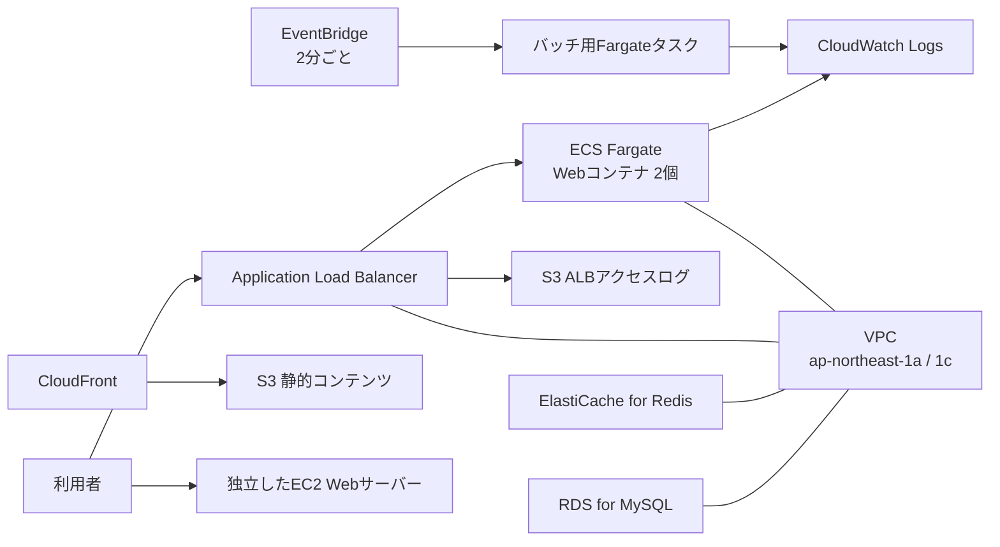

# Terraformで学ぶAWS構成(by Copilot)

このリポジトリは、TerraformのコードからAWSのネットワークやサーバー、データベースなどを作る学習用プロジェクトです。Terraformのファイルは主に [`example/`](example/) にあります。AWSのリージョンは東京（`ap-northeast-1`）です。

## どんな構成か

`example/` 直下のTerraformファイルは、ひとつの構成として読み込まれます。大きく分けて、VPC内のWebアプリケーションと、独立したEC2のWebサーバーがあります。



図の詳細は [`example/aws-architecture.drawio`](example/aws-architecture.drawio) を参照してください。図は主なネットワークとサービスを示したものです。RDS、Redis、SSM Parameter Storeなど、Terraformに定義されたすべての設定を図示しているわけではありません。

### ネットワークとWebアプリケーション

- **VPC** はAWS内に作る専用ネットワークです。CIDRは `10.0.0.0/16` です。
- VPCをパブリックサブネットとプライベートサブネットに分け、東京リージョンの2つのアベイラビリティゾーン（`ap-northeast-1a` と `ap-northeast-1c`）に配置します。サブネットはネットワークをさらに小さく分けた区画です。
- **Internet Gateway** はVPCとインターネットをつなぎます。**NAT Gateway** はプライベートサブネットから外へ通信するときに使います。プライベートサブネットのリソースに、インターネットから直接接続するための経路は作りません。
- **Application Load Balancer（ALB）** がHTTPリクエストを受け取り、プライベートサブネットのECSタスクに振り分けます。現状、有効なリスナーはHTTPの80番です。443番や8080番のセキュリティグループはありますが、そのポートのリスナー設定はコメントアウトされています。
- **ECS on Fargate** はコンテナを実行する仕組みです。Nginxコンテナのタスクを2つ起動し、ALBからのリクエストを受け付けます。
- これとは別に、`http_server/` モジュールから **EC2** を1台作ります。HTTPサーバーを起動しますが、カスタムVPC内のALB/ECSとは独立した構成です。

### データ、配信、バッチ処理

- **RDS for MySQL** はプライベートサブネットに作成する設定です。現在の設定はMySQL 8.0、`db.t3.micro`、Single-AZ、自動バックアップ保持期間0日です。
- **ElastiCache for Redis** はキャッシュ用の設定です。Redisのパラメータグループ、サブネットグループ、レプリケーショングループを定義しています。
- **S3** には用途の異なるバケットがあります。非公開データ用、CloudFrontから配信するコンテンツ用、ALBアクセスログ用です。非公開バケットはバージョニングとSSE-S3暗号化を設定しています。ALBログ用バケットには、保存から180日後に削除する設定があります。
- **CloudFront** は公開コンテンツ用S3バケットの前段でコンテンツを配信します。S3へのアクセスはCloudFront経由に制限する設定です。
- **EventBridge** は2分ごとにバッチ用ECSタスクを起動します。タスク定義ではコンテナイメージや実行コマンド、ログ出力先などを指定します。
- ECSのコンテナログは **CloudWatch Logs** に保存し、ロググループごとに180日で保持する設定です。
- **SSM Parameter Store** はアプリケーションが使う設定値やパスワードを受け渡すために定義されています。`SecureString` は保存値を暗号化する種類です。

### 権限と暗号化

- **IAM** はAWSサービスに何を許可するかを設定します。コードでは、ECSタスク実行用、EventBridgeからECSを起動するためのロールなどを作成します。
- **KMS** は暗号化に使う鍵を管理します。鍵の自動ローテーションを有効にしています。
- S3の設定はSSE-S3を使っており、作成したKMSキーを指定していません。RDSではKMSキーを指定しています。

## Terraformのコードの読み方

- `resource` はAWSに作成するリソースを表します。たとえば `aws_vpc` はVPC、`aws_db_instance` はRDSです。
- `data` は既存の情報を参照します。たとえばAWS管理のIAMポリシーを読み込むときに使います。
- `module` は、よく使う設定をまとめて再利用する仕組みです。`security_group/` はセキュリティグループ、`iam_role/` はIAMロール、`http_server/` はEC2 Webサーバーの設定をまとめています。
- `variable` はモジュールへ渡す値、`output` は作成後に表示する値です。たとえばEC2の公開DNS名やALBのURLを出力します。
- リソース同士を `aws_vpc.example.id` のように参照すると、Terraformは依存関係を読み取り、必要な順番で作成します。
- `lifecycle` は、変更や削除時の扱いを調整します。`ignore_changes` を使うと、指定した項目の変更をTerraformが無視します。

## ファイルの場所

| ファイル / ディレクトリ | 内容 |
| --- | --- |
| `example/main.tf` | AWSプロバイダー、モジュール呼び出し、出力 |
| `example/network.tf` | VPC、サブネット、ルート、ゲートウェイ、セキュリティグループ |
| `example/lb.tf` | ALB、リスナー、ターゲットグループ |
| `example/ecs.tf` | ECS/Fargate、バッチ、IAMロール、CloudWatch Logs |
| `example/db.tf` | RDS for MySQLとElastiCache for Redis |
| `example/s3.tf` | S3、CloudFront、ALBログ |
| `example/iam.tf`、`example/kms.tf` | IAM権限とKMSキー |
| `example/ssm.tf` | SSM Parameter Storeの値 |
| `example/*_definitions.json` | ECSコンテナのイメージ、コマンド、ログなど |
| `example/security_group/` | セキュリティグループ用モジュール |
| `example/iam_role/` | IAMロール用モジュール |
| `example/http_server/` | EC2 Webサーバー用モジュール |
| `example/02/`、`example/03/` など | ルート構成とは別の学習用サンプル |

## Terraformを実行するとき

AWSの認証情報を設定し、作業ディレクトリを `example/` にしてから実行します。

```sh
cd example
terraform init
terraform fmt -recursive
terraform validate
terraform plan
terraform apply
```

`plan` で作成・変更・削除されるものを確認してから `apply` してください。AWSリソースによっては料金がかかります。不要になったリソースを削除するときの `terraform destroy` も、対象をよく確認してから実行してください。

## チームで共有する前の注意

- **パスワードなどの秘密情報をTerraformのコードやGitに保存しないでください。** 現在の学習用コードには、データベースやSSM Parameter Storeに渡す値がコード内に直接書かれています。実際の認証情報に置き換えず、共有・適用前に安全な受け渡し方法へ変更してください。
- `SecureString` にしても、値をTerraformコードに直接書くとコードやTerraformの状態ファイルに残る可能性があります。状態ファイルには他の設定値も含まれるため、Gitに追加せず、アクセスを制限して保管してください。
- Free Tierで利用できるインスタンスや機能は、AWSアカウントや時期によって異なります。ここに書かれた設定が無料になることを保証するものではありません。作成前に `terraform plan` とAWSの料金を確認してください。
- 学習中の設定には、AWSで利用できるエンジンのバージョンやサービスの仕様変更により、そのままでは作成できないものがあります。エラーが出た場合はAWS側で利用可能なバージョンや設定を確認してください。
